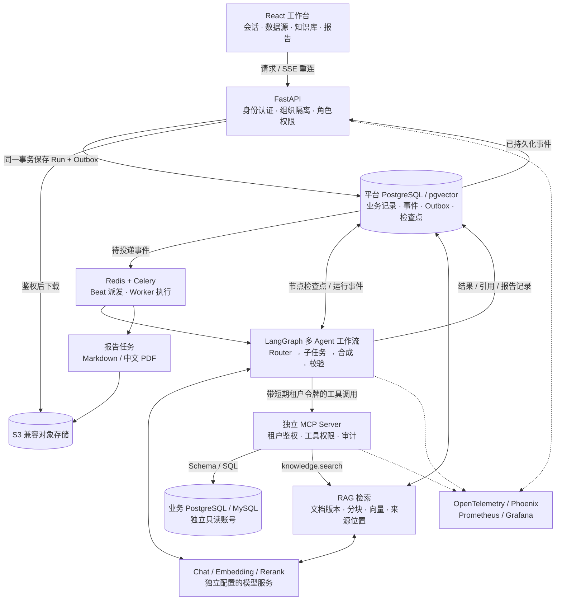
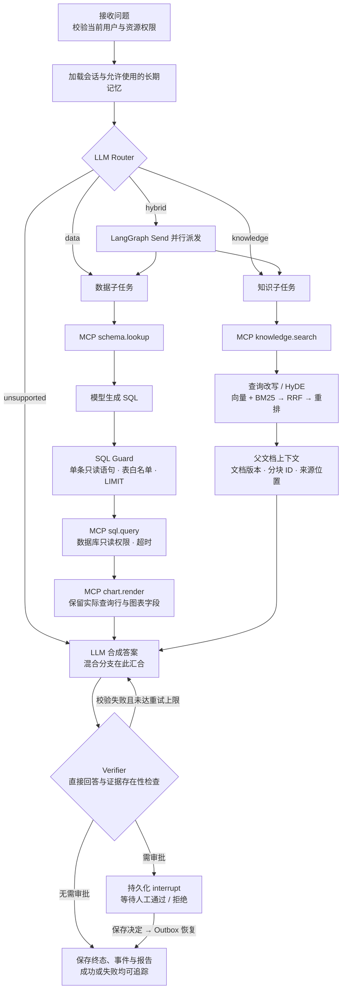

# SupplyChain Agent

面向制造业供应链的多租户智能分析系统。将业务数据库、知识库和多 Agent 工作流连接起来，让自然语言问题经过受控查询与证据校验，形成包含 SQL、数据表、图表和引用的分析报告。

前端工作台覆盖数据接入、知识入库、分析会话、报告管理、组织权限和运行审计。后端采用 **FastAPI + LangGraph + MCP**，通过 **PostgreSQL Checkpointer、Celery 和事务 Outbox** 管理异步执行与恢复。

## 能做什么

- **多 Agent 协作**：模型判断 `data`、`knowledge`、`hybrid` 或 `unsupported`；混合问题并行运行数据与知识子任务，再合成回答。
- **受控数据分析**：模型根据 Schema 规划 SQL，经过 AST 安全检查、表白名单、行数限制和数据库只读权限后执行。
- **带来源的知识检索**：父子分块、查询改写与 HyDE、向量/BM25 双路召回、RRF 融合、重排和父文档上下文。
- **可追溯交付**：保留运行 ID、检查点线程 ID、Trace ID、执行 SQL、查询行、图表字段及文档引用；支持 Markdown/PDF 报告。
- **持久化与人工审批**：执行状态保存在 PostgreSQL；需要审批的操作暂停并等待决定，审批结果经 Outbox 派发恢复。
- **流式交互与故障处理**：SSE 状态流、事件重放、取消、重试、Worker 心跳和失败记录。
- **组织与角色边界**：租户资源隔离、RBAC、MCP 短期租户令牌、审计，以及用户可关闭、查看和删除的长期记忆。

Chat、Embedding、Rerank 通过环境变量接入服务。未配置模型或真实调用失败时会返回明确错误与 Trace ID，不以模拟结论替代真实分析。

## 系统架构

[查看高清系统架构图](docs/diagrams/system-architecture.svg) · [查看高清 Agent 执行图](docs/diagrams/agent-workflow.svg)



## 一次问题如何完成



Verifier 检查直接回答是否为空，以及是否至少存在查询行或引用；它并不证明每个结论都正确。路由、SQL 规划、答案合成和记忆提取会调用模型。普通只读分析不默认要求人工审批；MCP 报告导出请求有单独的审批流程。异常与降级路径、SSE 重连和报告下载链路见 [架构说明](docs/ARCHITECTURE.md)。

## 本地启动

需要 Docker 与 Docker Compose。试运行配置使用环境文件覆盖功能，要求 Compose 2.24.4 或更新版本。仅运行容器时，不必额外安装本地 Python 或 Node.js。

```bash
git clone https://github.com/Cliff-fen/SupplyChain-Agent.git
cd SupplyChain-Agent
cp .env.example .env
```

Windows PowerShell 使用 `Copy-Item .env.example .env`。编辑 `.env`，填写自己的模型接口并替换签名、凭据加密和 MCP 服务密钥。真实密钥不进入源码或前端构建参数。

| 配置 | 变量 |
| --- | --- |
| 对话与结构化生成 | `SUPPLYMIND_CHAT_BASE_URL`、`SUPPLYMIND_CHAT_MODEL`、`SUPPLYMIND_CHAT_API_KEY` |
| 文档向量化 | `SUPPLYMIND_EMBEDDING_BASE_URL`、`SUPPLYMIND_EMBEDDING_MODEL`、`SUPPLYMIND_EMBEDDING_API_KEY`、`SUPPLYMIND_EMBEDDING_DIMENSION` |
| 专用重排（可选） | `SUPPLYMIND_RERANK_BASE_URL`、`SUPPLYMIND_RERANK_MODEL`、`SUPPLYMIND_RERANK_API_KEY` |
| JWT 签名 | `SUPPLYMIND_JWT_SECRET` |
| 数据源凭据加密 | `SUPPLYMIND_CREDENTIAL_KEY`（Fernet 格式） |
| MCP 服务间鉴权 | `SUPPLYMIND_MCP_SERVICE_SECRET` |

变量统一使用 `SUPPLYMIND_` 前缀。专用重排未配置或不可用时，检索按现有策略尝试 LLM 重排，再回退到融合排序；这不等于专用 Rerank 服务已连接。

使用镜像生成本地随机密钥，分别填入上述三个安全配置；输出只保存在你自己的环境中：

```bash
docker compose build api
docker compose run --rm --no-deps api python -c "import secrets; print(secrets.token_urlsafe(48))"
docker compose run --rm --no-deps api python -c "from cryptography.fernet import Fernet; print(Fernet.generate_key().decode())"
docker compose run --rm --no-deps api python -c "import secrets; print(secrets.token_urlsafe(48))"
```

启动依赖，执行迁移，再启动应用：

```bash
docker compose up -d postgres redis minio minio-init demo-postgres retail-postgres demo-mysql
docker compose run --rm --no-deps api alembic upgrade head
docker compose up -d --build
docker compose ps
curl --fail http://localhost:8000/api/v1/health/live
curl --fail http://localhost:8000/api/v1/health/ready
```

健康探针通过代表进程与基础依赖就绪，**不代表 Chat、Embedding、Rerank 均已验证**。模型服务需要分别验证。配置 Embedding 后，可导入随仓库提供的示例知识文档：

```bash
docker compose exec -T api python -m scripts.seed_demo_content
```

| 入口 | 本地地址 |
| --- | --- |
| 工作台 | http://localhost:5173 |
| API 文档 | http://localhost:8000/docs |
| MCP | http://localhost:8001/mcp |
| 对象存储控制台 | http://localhost:9001 |

开发环境会创建 `demo-factory`、`demo-south` 两个演示组织。`admin@demo.local`、`analyst@demo.local`、`viewer@demo.local` 对应管理员、分析师和只读成员；演示密码为 `ChangeMe123!`。这些是公开测试账号，**不得用于公网部署**。Compose 内数据库与对象存储的默认口令也仅限隔离的本地开发环境。

开启可观测性组件：

```bash
docker compose --profile observability up -d
```

同时设置 `SUPPLYMIND_OTEL_EXPORTER_OTLP_ENDPOINT=http://otel-collector:4318/v1/traces` 后重建相关服务容器；Phoenix、Prometheus、Grafana 分别位于 `6006`、`9090`、`3000` 端口。可选模型网关使用 `enterprise-ai` Profile。完整配置见 [CONFIGURATION](docs/CONFIGURATION.md)。

## 代码结构

```text
backend/
  app/agents/          LangGraph 状态、节点、执行器与运行时
  app/mcp_runtime/     带租户身份的 MCP Client
  app/mcp_server.py    独立 MCP Server
  app/rag/            多路检索、融合、重排与引用
  app/memory/         长期记忆策略与用户控制
  app/core/           配置、认证与 SQL Guard
  app/modules/        组织、数据源、知识库、报告和审计
  app/services/       模型、事件、报告、存储等服务
  alembic/            数据库迁移
  scripts/            Worker、评测、数据导入与部署检查
  tests/              后端自动化测试
frontend/             React 工作台、SSE 客户端与界面测试
database/             合成演示数据和只读账号初始化
infra/                Helm、指标、Trace 和模型网关配置
docs/                 架构、API、配置、验收及回滚说明
```

## 测试与验收

后端测试使用隔离数据库，不连接你的本地业务数据库：

```bash
docker compose run --rm --no-deps api pytest -q -p no:cacheprovider
docker compose run --rm --no-deps api ruff check app scripts tests
docker compose run --rm --no-deps api python -m scripts.evaluation_gate
docker compose run --rm --no-deps api alembic heads
```

前端单元测试与构建（Node.js 22）：

```bash
cd frontend
npm ci
npm test
npm run build
```

浏览器端到端测试需要已启动的服务；涉及知识库、历史报告和 PDF 的用例还需要完成真实模型配置、文档摄取及至少一次分析与导出：

```bash
npx playwright install chromium
PLAYWRIGHT_BASE_URL=http://localhost:5173 npm run test:e2e
```

CI 的单元测试、规则评测和静态扫描不替代真实模型端到端验收。完整浏览器测试保留为显式手动触发的工作流，使用部署方提供的独立验收地址；不会默认消费模型额度。

验收应逐次保留 `run_id`、`checkpoint_thread_id`、Trace ID、SSE 序号、SQL/行数据、引用文档版本、导出记录及对象哈希。业务结果、令牌、日志、数据库备份和验收截图应保存在私有目录。步骤见 [验收协议](docs/ACCEPTANCE_PROTOCOL.md) 与 [检查清单](docs/ACCEPTANCE_CHECKLIST.md)。

## 部署与运维

- [API 参考](docs/API_REFERENCE.md)
- [配置说明](docs/CONFIGURATION.md)
- [Helm 部署](docs/HELM_DEPLOYMENT.md)
- [试运行部署](docs/TRIAL_DEPLOYMENT.md)
- [回滚手册](docs/ROLLBACK_RUNBOOK.md)
- [安全问题处理](SECURITY.md)

公开部署前须替换开发凭据、关闭演示账号初始化，配置 TLS、访问边界和外部密钥管理。迁移与回滚先在隔离环境验证；不要通过删除数据卷来“恢复”运行环境。
