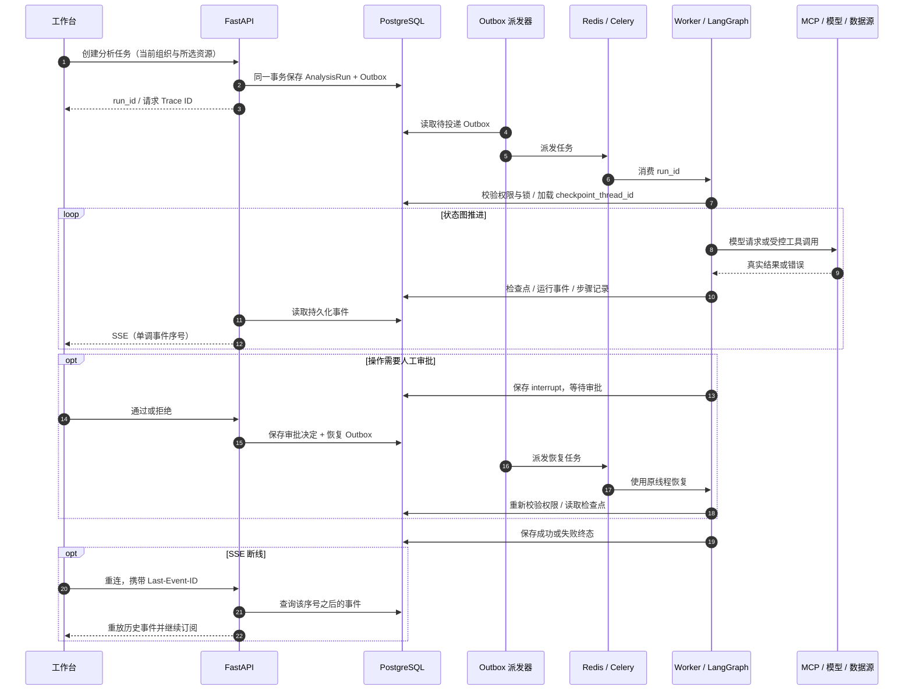
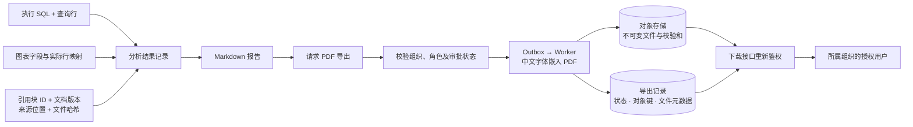

# 架构与数据流

## 运行边界

浏览器通过 FastAPI 获取工作台数据、创建任务并订阅 SSE。API 与 Celery Worker
共享平台 PostgreSQL 和 Redis；业务数据库使用独立只读账号访问，不与平台数据库混用。
MCP Server 独立部署，工具调用必须携带短期租户令牌，并再次校验权限与资源范围。

| 组件 | 职责 | 代码入口 |
| --- | --- | --- |
| API | 身份与资源授权、创建任务、审批、事件与下载 | `backend/app/api.py` |
| Worker / Beat | 消费任务、Outbox 投递、心跳及周期任务 | `backend/scripts/worker.py` |
| 执行器 | 准备上下文、绑定真实模型和工具、运行与恢复状态图 | `backend/app/agents/executor.py` |
| 状态图 | Router、并行派发、合成、校验、审批与终态 | `backend/app/agents/graph.py` |
| Checkpointer | 保存图执行状态、节点写入与中断恢复点 | `backend/app/agents/runtime.py` |
| MCP | Schema、SQL、检索、图表和报告导出申请 | `backend/app/mcp_server.py` |
| RAG | 多路召回、融合、重排、父块与引用映射 | `backend/app/rag/retrieval.py` |
| 模型适配 | Chat、Embedding、Rerank、路由、SQL 规划和答案 | `backend/app/services/llm.py` |
| 长期记忆 | 用户偏好白名单、置信度、版本和过期控制 | `backend/app/memory/service.py` |

## Agent 节点与异常路径

真实执行器为状态图注入模型路由、数据/知识子任务、模型答案合成和证据检查。
Router 输出 `data`、`knowledge`、`hybrid` 或 `unsupported`。混合路由通过 `Send`
派发两个子任务；它们返回状态后，由合成节点统一处理。

- Router 调用异常时，执行器记录降级事件并尝试混合路径，不将降级伪装为模型判断。
- 数据子任务先取 Schema，再让模型规划 SQL。执行前的 SQL Guard 与 MCP/数据源层限制共同生效；SQL 失败允许有限纠正，不无限重试。
- 知识子任务进行查询改写、HyDE、向量和 BM25 召回、RRF 融合及重排；引用保留文档/分块定位信息。重排失败可降级，检索没有证据不能伪造引用。
- 答案由模型合成。当前 Verifier 检查直接回答非空，且至少有查询行或引用；它不是模型裁判，也不做逐项事实证明。失败后按图中上限回到合成节点，达到上限仍失败则保留失败终态。
- 普通只读回答无需默认审批。答案要求审批时使用 LangGraph `interrupt`；`report.export` 工具的导出申请另行进入审批和任务队列。
- 流式答案调用失败时可使用已生成的结构化答案并记录降级；模型完全不可用时不生成模拟结论。

## 持久化、SSE 与恢复

HTTP 请求与异步 Worker 可能有不同 Trace ID；一次重试也可能有新的 Trace。
应通过 `run_id` 关联，不能假定整个异步链只有一个 Trace ID。
检查点在线程内逐步写入，并非任务结束后才统一保存；进程中断时尚未提交的执行不能视为已持久化。
Worker 的锁、检查点和结果持久化用于减少重复执行，任务恢复仍需验证幂等性与外部副作用。

PostgreSQL 模式使用 `AsyncPostgresSaver` 与 `AsyncPostgresStore`；SQLite 单元测试模式使用内存实现，
不能据此宣称具备跨进程恢复能力。长期记忆另存用户可复用偏好，并不代替图检查点或审计事件。

## 报告与来源追踪

通过 MCP `report.export` 发起的请求需要审批；报告中心的直接导出接口按自身权限检查处理，
二者不能混称为所有 PDF 都要审批。PDF 导出失败保留失败记录，可重试并生成新的导出记录。
对象存在不代表任意用户有下载权限，下载接口仍检查组织和角色。

## 部署、测试与边界

开发 Compose 包含演示账号与合成数据；试运行使用显式迁移与外部配置，不能沿用开发凭据。
基础健康探针检查进程与关键依赖，不替代真实模型调用、Worker 恢复、跨租户访问和来源对账验收。
单元测试可以隔离或替换外部依赖；运行中的真实业务链不得用测试替身冒充成功。

入口与目录见 [README](../README.md)，配置见 [CONFIGURATION](CONFIGURATION.md)，
故障与证据核查步骤见 [ACCEPTANCE_PROTOCOL](ACCEPTANCE_PROTOCOL.md)。
